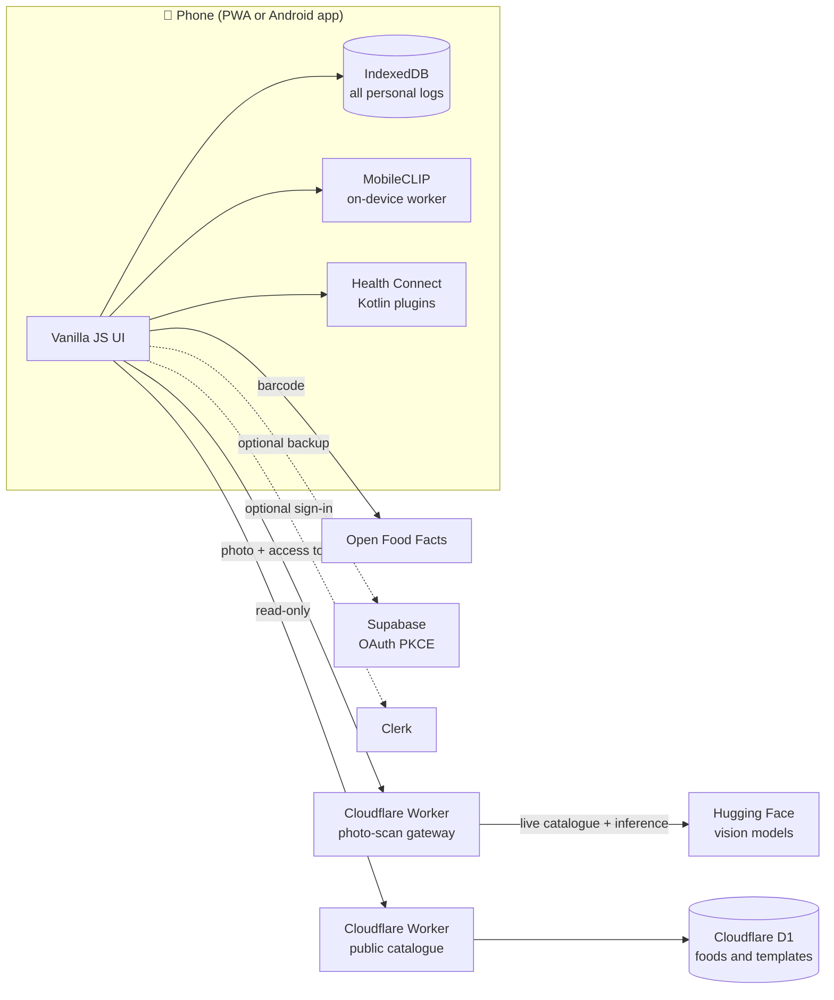

# 💪 Recomp

### An offline-first fitness and nutrition tracker that uses AI carefully

[](https://t3ch-miner.github.io/recomp-fitness-app/)
[](https://github.com/T3ch-miNer/recomp-fitness-app/actions/workflows/ci.yml)


Recomp helps people train and eat for body recomposition: logging workouts, tracking nutrition and body measurements, and following structured programmes. It runs as a PWA on GitHub Pages and as an Android app through Capacitor.

The interesting part is how it uses AI. Every model output, whether a photo-based meal estimate or a generated training plan, is treated as **untrusted input**. It's validated against a schema, range-checked and shown to the user for review before anything is saved.

---

## ✨ Features

**Training**
- Full-body templates for beginners plus a large library of structured workouts, including round-based giant sets
- Rest timers, warm-ups, exercise guides and demonstration videos
- Workout history, muscle-focus views and recovery cues

**Nutrition**
- Food diary with 290+ reference foods, popular Indian dishes and an Open Food Facts barcode lookup
- Weekly meal planner with a recipe book, dinner-to-lunch scheduling and an automatic shopping list
- Optional AI photo scanning for whole-meal calorie and macro estimates

**Body and wellbeing**
- Body measurements and progress charts
- Daily targets for calories, macros, fibre, water and steps
- Insights linking mood, workouts and screen time
- Optional Android Health Connect sync for steps and active calories

**Personalised plans (Advanced mode)**
- Builds a readable planning prompt from the user's profile and measurements
- The user pastes it into an LLM of their choice and imports the JSON plan back
- Recomp validates, previews and only imports after a second confirmation

---

## 🧠 How AI is used, and kept in check

### 1. On-device food recognition
A Web Worker runs **MobileCLIP** (`Xenova/mobileclip_s0`) through Transformers.js in WebAssembly for zero-shot food classification. Photos never leave the device.

### 2. Cloud photo scanning through a private gateway
For richer whole-dish estimates, the app calls a **Cloudflare Worker** that proxies Hugging Face Inference Providers.

- **Dynamic model selection.** Before each scan the Worker reads the live Hugging Face model catalogue and picks an affordable, image-capable model. If a provider rejects that model, it tries one alternative. It never retries on auth, quota or billing errors.
- **Secrets stay server-side.** The Hugging Face token is a Worker secret. The app uses a separate access token and actively rejects anything that looks like a Hugging Face or OpenAI key.
- **Strict output validation.** Responses are parsed, size-limited and range-checked per nutrient. Anything invalid becomes a clear error, never a silent bad entry.
- **Honest labelling.** Saved entries are marked as AI estimates with the model name, and the user edits every field before saving.

### 3. LLM-generated training plans
Advanced mode deliberately keeps the user in control of what's shared.

```
Profile + measurements → readable prompt → user's own LLM → recomp-plan.json
        → schema and range validation → preview → confirm → saved locally
```

Plans follow the versioned `recomp-personal-plan-v1` schema (see [`examples/recomp-personal-plan-example.json`](examples/recomp-personal-plan-example.json)). The validator rejects missing fields, unrealistic targets, very low calorie goals and oversized workouts, and it never evaluates imported code.

---

## 🏗️ Architecture



| Layer | Technology |
|---|---|
| Frontend | Vanilla JavaScript ES modules, HTML, CSS, service worker |
| Mobile | Capacitor 8 with custom Kotlin plugins for Health Connect, auth and wellbeing |
| Local storage | IndexedDB, offline-first |
| On-device ML | Transformers.js, MobileCLIP, WebAssembly |
| Cloud AI | Cloudflare Workers proxying Hugging Face Inference Providers |
| Public catalogue | Cloudflare Workers + D1, read-only |
| Auth and backup | Supabase OAuth with PKCE, Clerk, both optional |
| Testing and CI | Node's built-in test runner, GitHub Actions, debug APK builds |

---

## 🔒 Privacy by design

Health and body data is sensitive, especially under GDPR, so the defaults are conservative.

- Workouts, meals, measurements and photos live **only on the device** in IndexedDB.
- Cloud backup and sign-in are opt-in, and signing in doesn't upload anything by itself.
- The public catalogue API is read-only and never holds personal data.
- Nothing is sent to an LLM automatically. Users see the full prompt before copying it.
- No API keys are committed. Tokens live in Worker secrets.

---

## 🧪 Testing & CI

Tests use Node's built-in test runner (`node:test`), so there's no test framework to install. You'll need Node 22, the version in [`.nvmrc`](.nvmrc).

```bash
npm install            # installs ESLint and the Capacitor packages
npm test               # run the full suite
npm run lint           # ESLint
npm run test:coverage  # tests plus an lcov report in coverage/lcov.info
```

The suite has 300+ tests covering plan validation, nutrition maths, AI response parsing, workout flows, navigation and storage.

**The LLM plan flow** has its own offline tests. [`tests/llm-prompt-builder.test.mjs`](tests/llm-prompt-builder.test.mjs) checks that the prompt embeds the right profile and measurements, keeps unknown fields out and includes the safety and format instructions. Contract tests also confirm that the limits the prompt states are the ones the importer enforces. [`tests/llm-plan-import.test.mjs`](tests/llm-plan-import.test.mjs) feeds sample model responses from [`tests/fixtures/llm-responses`](tests/fixtures/llm-responses) through the importer. The good ones must import, and the bad ones (fenced or truncated JSON, wrong types, out-of-range values, crash-diet targets) must be rejected with a specific message. No model is ever called, and a helper fails the test if anything tries to use the network.

**CI** ([`.github/workflows/ci.yml`](.github/workflows/ci.yml)) runs on every pull request to `main` and every push to `main`, with two required checks:

| Check | What it does |
|---|---|
| **Lint** | Runs ESLint with a correctness-only config ([`eslint.config.mjs`](eslint.config.mjs)) |
| **Test & coverage** | Runs the full suite and fails on any failing test, then posts a coverage summary and uploads `coverage/lcov.info` as an artifact |

Both jobs use the Node version from `.nvmrc` with npm caching, have a read-only token and use no secrets. A separate workflow builds a debug Android APK on pushes to `main`.

---

## ▶️ Run locally

```bash
git clone https://github.com/T3ch-miNer/recomp-fitness-app.git
cd recomp-fitness-app
python -m http.server 8000
# open http://localhost:8000
```

To build the Android app:

```bash
npm install
npm run build:android-web
npx cap add android
npx cap sync android
python3 scripts/integrate-android-native.py
cd android && ./gradlew :app:assembleDebug
```

### Optional integrations

| Guide | What it sets up |
|---|---|
| [`PHOTO_SCAN_SETUP.md`](PHOTO_SCAN_SETUP.md) | Cloudflare Worker and Hugging Face photo scanning |
| [`GOOGLE_HEALTH_CONNECT_SETUP.md`](GOOGLE_HEALTH_CONNECT_SETUP.md) | Supabase Google sign-in and Android Health Connect |
| [`CLERK_SETUP.md`](CLERK_SETUP.md) | Clerk sign-in |
| [`MEAL_PLANNER.md`](MEAL_PLANNER.md) | Recipes and the weekly meal planner |
| [`docs/PERSONALISED_FITNESS_V3.md`](docs/PERSONALISED_FITNESS_V3.md) | Advanced mode and the plan schema |

---

## 🗺️ Roadmap

- [ ] **Evaluation harness for photo scanning.** A labelled meal set measuring calorie and macro error, valid-JSON rate, latency and cost per model
- [ ] **Plan-generation evals.** Run the planning prompt across several models and report schema pass rates
- [ ] **Analytics layer.** Model adherence and progress metrics on synthetic data, with a dashboard
- [ ] Production auth on a custom domain, and a Play Store release

---

> Recomp gives estimates, not medical or nutritional advice. AI outputs are approximate and always need review.

### Built by Rahul Pushpala

**Data · Analytics · Engineering · Useful little products**

[](https://www.linkedin.com/in/rahulpushpala/)
